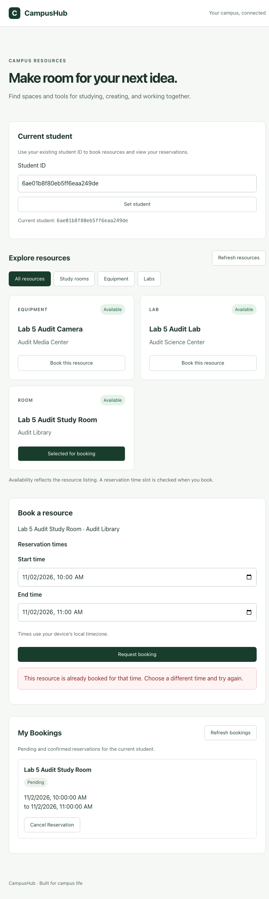

# Lab 5 — State management and error handling audit

Audit date: October 26, 2026 (America/Los_Angeles).

## Full-stack conflict result

**Passed through the UI against the actual backend and MongoDB.** Headless Chrome
loaded the Vite client, selected a seeded student and study room, and submitted
November 2, 2026, 10:00–11:00 in the browser's local timezone twice.

1. The first `POST /api/v1/reservations` returned `201`. The form cleared its times,
   displayed a success message, and refreshed My Bookings with one pending booking.
2. Submitting the same resource, student, and time window returned `409` from the
   real reservation service. No request interception was used for these submissions.
3. The form rendered this explicit `role="alert"` message:

   > This resource is already booked for that time. Choose a different time and try again.

4. The entered times remained visible, `aria-busy` returned to `false`, the fieldset
   and submit button became usable again, and the dashboard still showed one booking.
5. Browser runtime exception and unhandled promise rejection monitoring recorded
   no exceptions across the audit scenarios.



The audit used Chrome 156, Vite's development proxy, the existing Express app,
and a temporary MongoDB 8.0.15 single-node replica set on `127.0.0.1:27027`.
Fixture data lived in a uniquely named `campushub_lab5_audit_*` database.
An independent temporary Chrome profile was used. No new project dependency,
authentication endpoint, or production-only testing shortcut was introduced.

## Async workflow audit

| Workflow           | State and cleanup                                                                                               | Browser result                                                                                                                                                    |
| ------------------ | --------------------------------------------------------------------------------------------------------------- | ----------------------------------------------------------------------------------------------------------------------------------------------------------------- |
| Resource directory | `loading` and `error`; abort on cleanup                                                                         | Injected network failure displayed an alert, cleared loading, and re-enabled Refresh resources. Retry restored the cards.                                         |
| Booking submission | `submitting`, validation errors, request error, success; duplicate-submit guard; `finally` resets pending state | Real 409 preserved input and released submission state. A deliberately stalled request timed out after 15 seconds, displayed an error, and re-enabled submission. |
| My Bookings read   | `loading` and `loadError`; abort on cleanup; last successful list retained on failure                           | Injected 500 displayed an alert and released refresh state. The previous booking remained visible; Refresh bookings recovered.                                    |
| Cancellation       | `cancellingId`, `actionError`, success; `finally` releases the action                                           | Injected network failure preserved the displayed booking and re-enabled cancellation. A real retry removed the booking and reloaded the list.                     |
| Student switch     | Student-specific components remount; old reads abort                                                            | Switching to the second fixture student cleared previous action messages and showed the new student's empty dashboard.                                            |

Fault cases in this table were injected through Chrome's request interception;
they test the actual rendered components and hooks, but are simulated transport
and server failures. Booking creation, double-booking rejection, and successful
cancellation used the real backend and database.

## Changes made during the audit

The existing UI already handled conflicts and async errors explicitly. The missing
case was a request that never settles: native fetch had no request deadline, so
any loading or mutation indicator could otherwise remain active indefinitely.

- Added a shared 15-second request timeout in `client/src/api/campushubApi.ts`.
  It covers both fetching headers and reading JSON, returns `ApiError` with code
  `REQUEST_TIMEOUT`, and clears timers and abort listeners on every exit path.
- Preserved caller cancellation as `AbortError` so unmounts and superseded reads
  remain quiet rather than producing timeout banners.
- Updated cancellation error guidance to refresh server state before retrying.
  A lost response or timeout cannot prove whether a mutation reached the server.
  Requests are not retried automatically.
- Added regression tests for stalled requests, stalled response bodies, in-flight
  caller cancellation, and timer cleanup followed by a successful retry.

Changes stay in the authorized client scope, use explicit TypeScript types,
and keep HTTP access in the API module and async UI state in React hooks. The
backend Route -> Controller -> Service -> Model flow was unchanged.

## Validation and reproduction

- Client typecheck, production build, lint, and **20 tests** passed.
- Backend typecheck, production build, lint, and **57 integration tests** passed
  against the temporary replica set. Those tests use their own randomly named
  databases and clean them up.
- Browser checks above passed with no observed runtime exceptions.

With a local MongoDB replica set, run the usual backend and client development
servers as described in `client/README.md`. Use an existing student and available
resource. Submit a valid time range, then enter that exact range again for the same
resource. Inspect the network response for `409`/`DOUBLE_BOOKING`, verify the visible
alert, preserved input, enabled submit button, and single dashboard entry. Cancel
the booking and verify removal. The example backend environment uses a standalone
URI; reservation creation needs a replica-set configuration.

Run the checked-in regression suites separately:

```sh
# Repository root, with a replica set available at this URI:
MONGODB_TEST_URI='mongodb://127.0.0.1:27027/?replicaSet=lab5audit' npm test

cd client
npm run build
npm run lint
npm test
```

The recorded browser automation used Chrome's DevTools protocol and disposable
fixture scripts outside the repository. It is not part of the default `npm test`
suite; no browser testing framework was added. The temporary audit services and
fixture database were stopped and cleaned up after verification.
